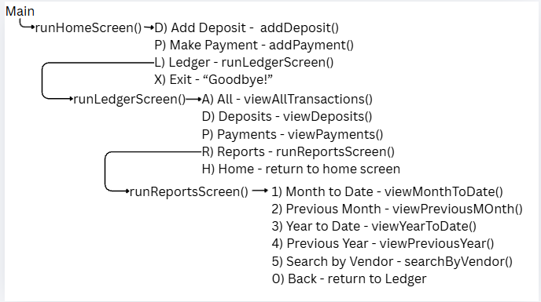

# Accounting Ledger
This is a command-line application that reads in and writes to a transactions CSV file. This application allows the user to conduct tasks like adding deposits, making payments, and viewing various filtered transaction lists.

## Features

- Allow user to attach a transactions CSV file to read/write
- Store all transactions in the file in a transactions arraylist
- Filter transactions arraylist as needed per menu function
- Three separate screens for usability
- Add deposits (Home)
- Add payments (Home)
- View all transactions (Ledger)
- View all deposits (Ledger)
- View all payments (Ledger)
- View Month to Date report (Reports)
- View Previous Month report (Reports)
- View Year to Date report (Reports)
- View Previous Year report (Reports)
- Search for transactions by vendor (Reports)

## How to run it

1. Open the 'accounting-ledger' project
2. Run 'App.java'
3. Enter the name of the file to be accessed (must be present in project root, or include filepath as needed)
4. Select from the menu options on the home screen
   5. Add deposit: enter the information as prompted to add a deposit to the ledger
   6. Make payment: enter the information as prompted to add a payment to the ledger
   7. Ledger: enter the Ledger screen
   8. Exit: end the program
8. Select from menu options on the ledger screen
   9. View all: view a list of every transaction
   10. View deposits: view a filtered list of just deposits
   11. View payments: view a filtered list of just payments
   12. Reports: enter the Reports screen
   13. Home: return to the home screen
14. Select from menu options on the reports screen
    15. Month to Date: filter transactions to see just the current month
    16. Previous Month: filter transactions to see just the previous month
    17. Year to Date: filter transactions to see just the current year
    18. Previous Year: filter transactions to see just the previous year
    19. Search by Vendor: filter transactions by vendor - enter the specific vendor when prompted
    20. Back: back to ledger screen


## Interesting code

Month to Date Filtering: This functionality really forces the developer to get familiar with the LocalDate class methods
```java
private static ArrayList<Transaction> filterPreviousMonth() {

        ArrayList<Transaction> previousMonthTransactions = new ArrayList<>();

        LocalDate previousMonth = LocalDate.now().minusMonths(1);

        System.out.println(" - Previous Month - ");

        for (Transaction transaction : transactions) {

            if (previousMonth.getMonth() == transaction.getDate().getMonth() && previousMonth.getYear() == transaction.getDate().getYear()) {

                previousMonthTransactions.add(transaction);

            }
        }

        return previousMonthTransactions;
    }
```

Format for transactions table output: Had help from Claude AI, but it creates such a nice looking table
```java
private static void displayTransactionsAsTable(ArrayList<Transaction> transactions) {
        // Used Claude to help me with formatting so each section is a set size
        // This method is drafted using Claude, revised by me for accuracy and judgment

        if (!transactions.isEmpty()) {

            System.out.printf("%40s", "TRANSACTIONS");
            System.out.println();
            System.out.println();
            System.out.printf("|%s|%s|%s|%s|%n", center("DATE", 12), center("DESCRIPTION", 26), center("VENDOR", 20), center("AMOUNT", 14));

            for (Transaction transaction : transactions) {

                System.out.printf("|%s|%s|%s| $%s|%n", center(transaction.getDate().toString(), 12), center(transaction.getDescription(), 26), center(transaction.getVendor(), 20), center(String.format("%.2f", transaction.getAmount()), 12));

            }

        }

    }

    private static String center(String text, int width) {
        // Used Claude to help me with formatting so each section is a set size
        // This method is drafted using Claude, revised by me for accuracy and judgment
        int leftover = width - text.length();

        if (leftover <= 0) {

            return text;

        }

        int left = leftover / 2;
        int right = leftover - left;

        return " ".repeat(left) + text + " ".repeat(right);

    }
```


## Screenshots
